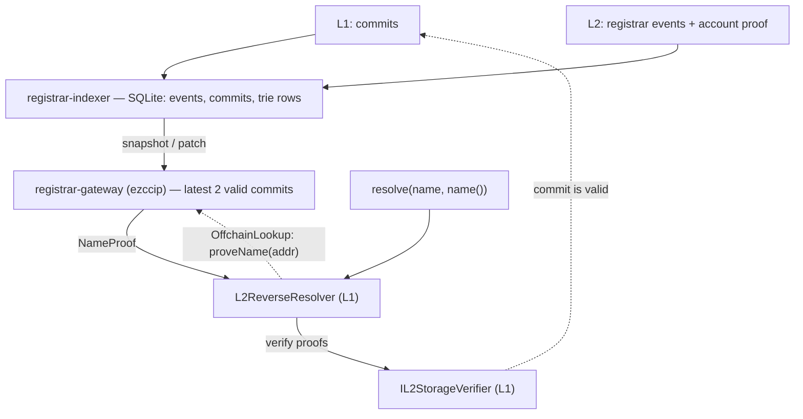

# primary-name-gateway

[](https://github.com/ensdomains/primary-name-gateway/actions/workflows/main.yml)

Trustless L1 resolution of ENS primary names stored on L2s, without an archive node at request time.

Each L2 has a reverse registrar holding its [ENSIP-19](https://docs.ens.domains/ensip/19) primary names. L1 resolves `{addr}.{coinType}.reverse` → `name()` with CCIP-Read: a gateway returns storage proofs of the registrar, and an L1 contract verifies them against the L2's state root as committed on L1.

## Chains

### Rollups

Proven from what the rollup itself commits to L1. **Delay** is how far behind the L2's tip the newest provable state is. Rollups with fault proofs can accept a commitment before it's final, once it has gone unchallenged for a while (`minAgeSec` / `minAgeBlocks`, set on the verifier and the indexer alike), which trusts an honest challenger to act within that time.

| chain | kind | frequency | trust | delay |
|---|---|---|---|---|
| [OP Mainnet](docs/optimism.md)<br>(10) | `op`: dispute games (super roots) | 1 h | fault proofs | `minAgeSec`<br>• `0`: ~7 days (finalized)<br>• `T`: T + ~40 min–1.5 h |
| [Base](docs/base.md)<br>(8453) | `op`: dispute games (output roots, `AggregateVerifier`) | ~20 min | TEE proofs, challengeable with ZK | `minAgeSec`<br>• `0`: ~5 days (finalized)<br>• `T`: T + ~1 h |
| [Arbitrum One](docs/arbitrum.md)<br>(42161) | `arbitrum`: BoLD assertions | 1 h | fault proofs (BoLD) | `minAgeBlocks`<br>• `0`: ~6.5 days (confirmed)<br>• `N`: N × 12 s + ~1.2–2.2 h (1,800: 7.7 h measured) |
| [Linea](docs/linea.md)<br>(59144) | `linea`: ZK finalizations | a few hours | validity proofs | ~2–4 h (final when posted) |

The early delays add up the time between commitments (frequency), the age of the L2 block a commitment names when it's posted (measured 2026-11-23: OP Mainnet ~20 min, Base ~35 min, Arbitrum ~1 h), and L1 finality (~13 min: the indexer only reads finalized L1). An early Arbitrum proof is a chain of assertions from the last confirmed one (about 6.4 days back), so it costs more the smaller `minAgeBlocks` is: 2.1M gas at 1,800 blocks, against ~600k confirmed-only.

### Sequencer

Proven from what the L2's sequencer or batcher posts, before the rollup commits to it: much fresher, trusting the batcher key instead of fault or validity proofs. Research: nothing is deployed.

| name | kind | frequency | trust | chains | delay |
|---|---|---|---|---|---|
| [OP Batch Inbox](docs/op-batch-inbox.md) | `inbox`: a batcher blob that starts a channel names its parent L2 block | ~1 min | the batcher key (`SystemConfig.batcherHash()`) | OP Mainnet, Base | ~25 min |

[docs/registrar.md](docs/registrar.md) covers the registrar contract, its storage layouts, and why its storage can be rebuilt from events. ENSIP-19 coin types are `0x80000000 | chainId`.

## How it works



1. **Indexer.** A chain-specific `CommitSource` follows L1 for commits of the L2's state. For each one, the indexer fetches what can't be rebuilt from events while the L2 still has it (at least the registrar's **account proof**), replays the registrar's events into its storage trie up to that block, and refuses the commit if the rebuilt storage root differs from the L2's. It keeps the tries of recent commits and serves them as rows.
2. **Gateway.** It holds the latest valid commits (2 by default) as **versioned trie rows** `(path, version = L2 block) → node` in a `NodeStore`. For OP Stack chains the rows are chunks: each node above depth 4 is its own row, and deeper nodes are grouped by their 4-nibble prefix, so Base is about 70,000 rows instead of 5M ([optimism.md](docs/optimism.md#chunks)). It bootstraps from a paged `/snapshot`, then only downloads `/patch` rows (what changed between commits). Proofs are built by copying rows, so the gateway has no trie in memory and hashes no nodes (only slot keys, and one root per commit it loads). Its state lives in the store, so a restart resumes with patches. Its HTTP side is CCIP-Read, plus JSON-RPC at `/rpc` answering `eth_getProof` and `eth_getStorageAt` for the registrar at the held commits' blocks, identical to an archive node's ([docs/gateway-rpc.md](docs/gateway-rpc.md)).
3. **Resolver.** `L2ReverseResolver` answers `resolve(name, name())` with `OffchainLookup` to the gateway's `proveName(address)`, then verifies the returned `NameProof` through the chain's `IL2StorageVerifier`:
   1. `verifyStorageRoot(commitProof, registrar, accountProof)`: the commit is valid and fresh on L1, and the account proof gives the registrar's storage root.
   2. `verifyStorageValues(storageRoot, slots, proof)`: the name's header slot and its `NameProof.dataSlots` data slots, which must agree with the header's length. Unset slots are proven absent. All slots share one proof, so a verifier can share work between them.

The serving rules are the same on every chain: the gateway serves the newest valid commit that has been valid for at least `GATEWAY_MARGIN_SEC` (so an L1 node that lags slightly still accepts it), and verifiers reject commits that are too stale (`maxSequenceLag` behind the anchor on OP, `maxBlockLag` L2 blocks on Linea, `maxBlockLag` L1 blocks for the batch inbox, `maxAgeBlocks` L1 blocks on Arbitrum): otherwise a gateway could prove a name from before it was changed. If the gateway's newest commit becomes invalid, it truncates back to its newest valid commit and patches from there. If the indexer no longer has the commit a gateway asks to patch from, the gateway falls back to a snapshot.

## Packages

| package | what |
|---|---|
| [`shared`](packages/shared) | Chain config and deployments, registrar layouts and events, row formats and provers for each trie kind ([trie.ts](packages/shared/src/trie.ts): Merkle-Patricia, [linea.ts](packages/shared/src/linea.ts): Linea), the indexer ↔ gateway JSON types, the batch inbox references ([brotli.ts](packages/shared/src/brotli.ts), [op-batch.ts](packages/shared/src/op-batch.ts)), and Arbitrum assertions ([arbitrum.ts](packages/shared/src/arbitrum.ts)). |
| [`registrar-indexer`](packages/registrar-indexer) | `RegistrarIndexer` (event replay, commits, tries of retained commits, kept as versioned rows in SQLite for OP Stack chains), a `CommitSource` per chain family (dispute games, Linea finalizations, batcher blobs, Arbitrum assertions), HTTP API. |
| [`registrar-gateway`](packages/registrar-gateway) | `NodeStore`, `RegistrarGateway` (sync + `proveName`), the [ezccip](https://github.com/adraffy/ezccip.js) endpoint. The library (`src/index.ts`) is runtime-agnostic; `src/main.ts` is the bun server. |
| [`contracts`](packages/contracts) | `L2ReverseResolver`, `IL2StorageVerifier`, and one verifier per chain family (`OPFaultVerifier`, `LineaVerifier`; research: `OPBatchInboxVerifier`), deployed per chain and shareable by other resolvers. |

## Gateway storage (`NodeStore`)

Rows are keyed by a string: a [chunk](docs/optimism.md#chunks) key for OP Stack chains, a Linea row path for Linea. `get(key, version)` reads the newest row ≤ version; `floor(prefix, before, version)` finds the greatest live path below a key (Linea exclusion proofs need the key just below a missing one).

| store | use |
|---|---|
| `MemoryNodeStore` | tests, ephemeral |
| `SqlNodeStore` + `bunSqliteAdapter(db)` | the bun server (`GATEWAY_DB`, default `data/gateway-<chain>.sqlite`) |
| `SqlNodeStore` + a Durable Object adapter | a Cloudflare Durable Object per chain: `ctx.storage.sql` as the store, `sync()` on an alarm, requests through `createGatewayHandler(gateway, …)`. See [docs/durable-objects.md](docs/durable-objects.md) for how it fits, a sketch, and the limits that matter. |

## Setup

```sh
git clone --recursive https://github.com/ensdomains/primary-name-gateway   # or: git submodule update --init (forge-std)
bun i
cd packages/contracts && forge build
```

`.env` (see [`.env.sample`](.env.sample)): any of `DRPC_KEY`, `ALCHEMY_KEY`, `INFURA_KEY`, or `RPC_URL_<chainId>` / `PROOF_RPC_URL_<chainId>`. [docs/rpc.md](docs/rpc.md) covers which provider is used for what, their known limits, and every environment variable.

## Run

```sh
bun run indexer:optimism # :8100 (bun run indexer / gateway: set INDEXER_CHAIN / GATEWAY_CHAIN yourself)
bun run gateway:optimism # :8200, from INDEXER_URL=http://localhost:8100
bun run indexer:linea    # :8101
bun run gateway:linea    # :8201
bun run indexer:base     # :8102
bun run gateway:base     # :8202
bun run indexer:base-inbox  # :8103 (research: docs/op-batch-inbox.md)
bun run gateway:base-inbox  # :8203
bun run indexer:arbitrum # :8104
bun run gateway:arbitrum # :8204
```

Indexer API: `GET /status` (`l2ChainId`, `l1ChainId`, commit kind, L2 block time, `minAgeSec`, sync position, commit counts), `/commits?status=valid&limit=2`, `/commits/:id`, `/snapshot?commit=ID&after=KEY`, `/patch?from=A&to=B`, `/changes?after=&until=`. `/snapshot` and `/patch` serve rows in the layout their `x-row-format` header names (OP Stack: [chunks](docs/optimism.md#chunks)). Responses are JSON, gzipped when the client accepts it: a Base `/snapshot` page (50,000 nodes in about 700 chunks) is about 9 MB, or 3.9 MB gzipped.

Env: see [docs/rpc.md#environment](docs/rpc.md#environment).

## Test

`bun run test` runs every offline group below. [CI](.github/workflows/main.yml) runs `bun run check`, `bun run lint`, and each group as its own job, so a failed one can be re-run alone. The anvil-based groups use [blocksmith](https://github.com/adraffy/blocksmith.js).

| script | what | needs |
|---|---|---|
| `test:unit` | the TypeScript tests below that need no chain | |
| `test:contracts` | forge tests | Foundry |
| `test:e2e` | the offline end-to-end tests, and `inline-node` | anvil |
| `test:inbox` | batch inbox: Solidity against the TypeScript references, and the verifier on mainnet fixtures | anvil |
| `test:kzg` | the indexer's KZG proofs against the precompile | anvil; downloads the KZG trusted setup once |
| `test:mainnet`, `test:fork` | against L1 mainnet forks (not in CI) | RPC keys, archive state |

- The tests:
  - Tries: [trie.test.ts](test/trie.test.ts) (the indexer's SQL row log against merkle-builder's `EthStorage` at every kept version: snapshots, patches, proofs, rebuilt out-of-order versions), [inline-node.test.ts](test/inline-node.test.ts) (nodes under 32 bytes, through to the verifier), [linea.test.ts](test/linea.test.ts) (Linea rows and multiproofs against merkle-builder's `LineaStorage`), [store.test.ts](test/store.test.ts) (both `NodeStore`s against an unpruned reference).
  - RPC: [l2.test.ts](test/l2.test.ts) (`eth_getLogs` range limits).
  - End to end: [offline.test.ts](test/offline.test.ts), [offline-base.test.ts](test/offline-base.test.ts), [offline-minage.test.ts](test/offline-minage.test.ts), [offline-linea.test.ts](test/offline-linea.test.ts) and [offline-arbitrum.test.ts](test/offline-arbitrum.test.ts) run mock L1 contracts and an in-memory L2 ([OP](test/fake-rollup.ts), [Linea](test/fake-linea.ts), [Arbitrum](test/fake-arbitrum.ts)) through the real indexer, gateway, verifier and resolver: name updates, invalid or skipped commits, stale commits, out-of-order games, and restarts.
  - Batch inbox: [brotli.test.ts](test/brotli.test.ts), [brotli-sol.test.ts](test/brotli-sol.test.ts), [op-batch-sol.test.ts](test/op-batch-sol.test.ts), [op-batch-verifier.test.ts](test/op-batch-verifier.test.ts) and [kzg.test.ts](test/kzg.test.ts) ([docs/op-batch-inbox.md](docs/op-batch-inbox.md)).
  - forge: unit tests, [LineaVerifier.t.sol](packages/contracts/test/LineaVerifier.t.sol) on real `linea_getProof` output, and [BrotliPrefix.t.sol](packages/contracts/test/BrotliPrefix.t.sol) (gas).
- `bun run test:mainnet` needs a running indexer (any chain) with a valid commit and RPC keys. It deploys the chain's verifier and the resolver on an anvil fork of L1 mainnet, resolves names through CCIP-Read, and checks every indexed name (or a sample of `MAINNET_SAMPLE`, with every long name) against the registrar.
- `bun run test:fork` runs `OPBatchInboxVerifier` on L1 mainnet forks (archive RPC).
- `bun run prove <address> <chain>` proves one address's primary name through a gateway (the port of `gateway:<chain>`, or `--gateway URL`). It only talks to the gateway, as a client would, so it works against any gateway, including one whose indexer is stopped or out of reach. It deploys the chain's verifier and a resolver pointing at the gateway on a blocksmith fork of L1, resolves the name through CCIP-Read, reads the L2 block from the proof's commit proof, and prints:

  ```
  name      "quelburr.base.eth"
  gateway   23 ms, 25,088-byte response
  verify    12,975,804 gas (verifyName on the L1 fork)
  proof     L2 block 61,419,983 (inbox: batch in L1 block 26,480,951)
  finalized L2 block 61,421,724: the proof is 1,741 blocks (6m) behind
  L2        matches L2ReverseRegistrar.nameForAddr at L2 block 61,419,983
  ```

  For OP Stack fault proofs, pass `--min-age SEC` when the indexer accepts games early (its `INDEXER_MIN_AGE_SEC`).

## References

- [ENSIP-19](https://docs.ens.domains/ensip/19) (multichain primary names), [ENSIP-10](https://docs.ens.domains/ensip/10) (wildcard resolution), [EIP-3668](https://eips.ethereum.org/EIPS/eip-3668) (CCIP-Read)
- [merkle-builder](https://github.com/ensdomains/merkle-builder): rebuilds storage tries from events (Merkle-Patricia and Linea)
- [ezccip.js](https://github.com/adraffy/ezccip.js): the CCIP-Read endpoint

## License

MIT. Vendored contract libraries are listed in [`packages/contracts/src/lib/README.md`](packages/contracts/src/lib/README.md).
