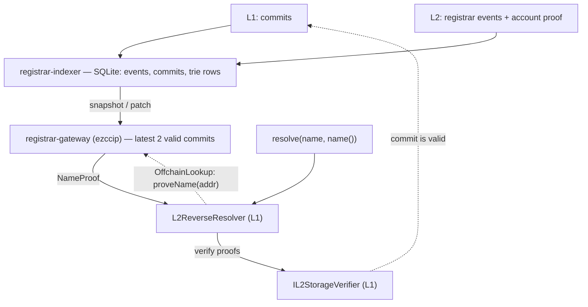

# primary-name-gateway

[](https://github.com/ensdomains/primary-name-gateway/actions/workflows/main.yml)

Trustless L1 resolution of ENS primary names stored on L2s, without an archive node at request time.

Each L2 has a reverse registrar holding its [ENSIP-19](https://docs.ens.domains/ensip/19) primary names. L1 resolves `{addr}.{coinType}.reverse` → `name()` with CCIP-Read: a gateway returns storage proofs of the registrar, and an L1 contract verifies them against the L2's state root as committed on L1.

## Chains

### Rollups

Proven from what the rollup itself commits to L1. **Delay** is how far behind the L2's tip the newest provable state is. Rollups with fault proofs can accept a commitment before it's final, once it has gone unchallenged for a while (`minAgeSec` / `minAgeL1Blocks`, set on the verifier and the indexer alike), which trusts an honest challenger to act within that time.

| chain | kind | every | trust | delay |
|---|---|---|---|---|
| [Optimism](docs/optimism.md)<br>(10) | `op`<br>dispute games<br>(super roots) | 1 h | fault proofs | `minAgeSec`<br>• `0`: ~7 days (finalized)<br>• `T`: T + ~40 min–1.5 h |
| [Base](docs/base.md)<br>(8453) | `op`<br>dispute games<br>(output roots) | ~20 min | TEE proofs, challengeable with ZK | `minAgeSec`<br>• `0`: ~5 days (finalized)<br>• `T`: T + ~1 h |
| [Arbitrum One](docs/arbitrum.md)<br>(42161) | `arbitrum`<br>BoLD assertions | 1 h | fault proofs (BoLD) | `minAgeL1Blocks`<br>• `0`: ~6.5 days (confirmed)<br>• `N`: N × 12 s + ~1.2–2.2 h (1,800: 7.7 h measured) |
| [Linea](docs/linea.md)<br>(59144) | `linea`<br>ZK finalizations | a few hours | validity proofs | ~2–4 h (final when posted) |

The early delays add up the time between commitments (every), the age of the L2 block a commitment names when it's posted (measured 2026-11-23: Optimism ~20 min, Base ~35 min, Arbitrum ~1 h), and L1 finality (~13 min: the indexer only accepts commits seen on finalized L1). An early Arbitrum proof is a chain of assertions from the last confirmed one (about 6.4 days back), so it costs more the smaller `minAgeL1Blocks` is: 2.1M gas at 1,800 blocks, against ~600k confirmed-only.

### Other

Proven from something other than the rollup's own commitments to L1, with a different trust assumption, usually for freshness.

| name | kind | every | trust | chains | delay |
|---|---|---|---|---|---|
| [OP Batch Inbox](docs/op-batch-inbox.md) | `inbox`<br>batcher blob parent L2 block | ~1 min | sequencer | Optimism, Base | ~25 min |

[docs/registrar.md](docs/registrar.md) covers the registrar contract, its storage layouts, and why its storage can be rebuilt from events. ENSIP-19 coin types are `0x80000000 | chainId`.

## How it works



1. **Indexer.** A chain-specific `CommitSource` follows L1 for commits of the L2's state. For each one, the indexer fetches what can't be rebuilt from events while the L2 still has it (at least the registrar's **account proof**), replays the registrar's events into its storage trie up to that block, and refuses the commit if the rebuilt storage root differs from the L2's. It keeps the tries of recent commits and serves them as rows.
2. **Gateway.** It holds the latest valid commits (2 by default) as **versioned trie rows** `(path, version = L2 block) → node` in a `NodeStore`. For OP Stack chains the rows are chunks: each node less than 4 nibbles deep is its own row, and deeper nodes are grouped by their 4-nibble prefix, so Base is about 70,000 rows instead of 5M ([optimism.md](docs/optimism.md#chunks)). It bootstraps from a paged `/snapshot`, then only downloads `/patch` rows (what changed between commits). Proofs are built by copying rows, so the gateway has no trie in memory and hashes no nodes (only slot keys, and one root per commit it loads). Its state lives in the store, so a restart resumes with patches. Its HTTP side is CCIP-Read, `GET /status`, and JSON-RPC at `/rpc` answering `eth_getProof` and `eth_getStorageAt` for the registrar at the held commits' blocks, identical to an archive node's ([docs/gateway-rpc.md](docs/gateway-rpc.md)).
3. **Resolver.** `L2ReverseResolver` answers `resolve(name, name())` with `OffchainLookup` to the gateway's `proveName(address)`, then verifies the returned `NameProof` through the chain's `IL2StorageVerifier`:
   1. `verifyStorageRoot(commitProof, registrar, accountProof)`: the commit is valid and fresh on L1, and the account proof gives the registrar's storage root.
   2. `verifyStorageValues(storageRoot, slots, proof)`: the name's header slot and its `NameProof.dataSlots` data slots, which must agree with the header's length. Unset slots are proven absent. All slots share one proof, so a verifier can share work between them.

The serving rules are the same on every chain: the gateway serves the newest valid commit (a commit becomes valid on finalized L1, so a client reading at latest is already past it, and stops being valid on latest L1, as the verifier does; `GATEWAY_SERVE_DELAY_SEC` can hold a new commit back a few seconds for clients reading at finalized), and verifiers reject commits that are too stale (`maxL2SequenceLag` behind the anchor on OP, `maxL2BlockLag` on Linea, `maxL1BlockLag` for the batch inbox, `maxAgeL1Blocks` on Arbitrum): otherwise a gateway could prove a name from before it was changed. If the indexer stops listing the gateway's newest commit as valid (invalid, pending again, or unknown to a rebuilt indexer), the gateway rewinds to its newest held commit and patches from there, or loads a snapshot if it holds none. If the indexer no longer has the commit a gateway asks to patch from, the gateway falls back to a snapshot.

## Packages

| package | what |
|---|---|
| [`shared`](packages/shared) | Chain config and deployments, registrar layouts and events, row formats and provers for each trie kind ([trie.ts](packages/shared/src/trie.ts): Merkle-Patricia, [linea.ts](packages/shared/src/linea.ts): Linea), the indexer ↔ gateway JSON types, the batch inbox references ([brotli.ts](packages/shared/src/brotli.ts), [op-batch.ts](packages/shared/src/op-batch.ts)), Arbitrum assertions ([arbitrum.ts](packages/shared/src/arbitrum.ts)), and the services' log ([log.ts](packages/shared/src/log.ts)). |
| [`registrar-indexer`](packages/registrar-indexer) | `RegistrarIndexer` (event replay, commits, tries of retained commits, kept as versioned rows in SQLite for OP Stack chains), a `CommitSource` per chain family (dispute games, Linea finalizations, batcher blobs, Arbitrum assertions), HTTP API. |
| [`registrar-gateway`](packages/registrar-gateway) | `NodeStore`, `RegistrarGateway` (sync + `proveName`), `createGatewayHandler`: `GET /status`, JSON-RPC at `/rpc`, and CCIP-Read ([ezccip](https://github.com/adraffy/ezccip.js)) on every other path. The library (`src/index.ts`) is runtime-agnostic; `src/main.ts` is the bun server. |
| [`contracts`](packages/contracts) | `L2ReverseResolver`, `IL2StorageVerifier`, and one verifier per chain family (`OPFaultVerifier`, `LineaVerifier`, `ArbitrumVerifier`; research: `OPBatchInboxVerifier`), deployed per chain and shareable by other resolvers. |

## Gateway storage (`NodeStore`)

Rows are keyed by a string: a [chunk](docs/optimism.md#chunks) key for OP Stack chains, a Linea row path for Linea. `get(key, version)` reads the newest row ≤ version; `floor(prefix, before, version)` finds the greatest live path below a key (Linea exclusion proofs need the key just below a missing one).

| store | use |
|---|---|
| `MemoryNodeStore` | tests, ephemeral |
| `SqlNodeStore` + `bunSqliteAdapter(db)` | the bun server (`GATEWAY_DB`, default `data/gateway-<port>.sqlite`): a cache that survives restarts, and starts over when its indexer serves another deployment |
| `SqlNodeStore` + a Durable Object adapter | a Cloudflare Durable Object per chain: `ctx.storage.sql` as the store, `sync()` on an alarm, requests through `createGatewayHandler(gateway)`. See [docs/durable-objects.md](docs/durable-objects.md) for how it fits, a sketch, and the limits that matter. |

## Setup

```sh
git clone --recursive https://github.com/ensdomains/primary-name-gateway   # or: git submodule update --init (forge-std)
bun i
cd packages/contracts && forge build
```

`.env` (see [`.env.sample`](.env.sample)): any of `DRPC_KEY`, `ALCHEMY_KEY`, `INFURA_KEY`, or `RPC_URL_<chainId>` / `PROOF_RPC_URL_<chainId>`. [docs/rpc.md](docs/rpc.md) covers which provider is used for what, their known limits, and every environment variable.

## Run

```sh
bun run indexer:optimism    # :8100 (bun run indexer: set INDEXER_CHAIN yourself)
bun run gateway:optimism    # :8200, serves what INDEXER_URL=http://localhost:8100 indexes
bun run indexer:linea       # :8101
bun run gateway:linea       # :8201
bun run indexer:base        # :8102
bun run gateway:base        # :8202
bun run indexer:base-inbox  # :8103 (research: docs/op-batch-inbox.md)
bun run gateway:base-inbox  # :8203
bun run indexer:arbitrum    # :8104
bun run gateway:arbitrum    # :8204
```

Indexer API: `GET /status` (the deployment's name and commit kind, `l1ChainId`, `l2ChainId`, the registrar and its layout, L2 block time, `minAgeSec` / `minAgeL1Blocks`, sync position, commit counts, the newest valid commit), `/commits?status=valid&limit=2`, `/commits/:id`, `/snapshot?commit=ID&after=KEY`, `/patch?from=A&to=B`, `/changes?after=&until=`. `/snapshot` and `/patch` serve rows in the layout their `x-row-format` header names (OP Stack: [chunks](docs/optimism.md#chunks)). Responses are JSON, gzipped when the client accepts it: a Base `/snapshot` page (50,000 nodes in about 700 chunks) is about 9 MB, or 3.9 MB gzipped.

Env: see [docs/rpc.md#environment](docs/rpc.md#environment).

## Test

`bun run test` runs every offline group below. [CI](.github/workflows/main.yml) runs `bun run check`, `bun run lint`, and each group as its own job, so a failed one can be re-run alone. The anvil-based groups use [blocksmith](https://github.com/adraffy/blocksmith.js).

| script | what | needs |
|---|---|---|
| `test:unit` | the TypeScript tests below that need no chain | |
| `test:contracts` | forge tests | Foundry |
| `test:e2e` | the offline end-to-end tests, and `inline-node` | anvil |
| `test:inbox` | batch inbox: Solidity against the TypeScript references, and the verifier on mainnet fixtures | anvil |
| `test:kzg` | the indexer's KZG proofs against the precompile | anvil; downloads the KZG trusted setup once |
| `test:mainnet`, `test:fork` | against L1 mainnet forks (not in CI) | RPC keys, archive state; `test:mainnet`: a running indexer |

- The tests:
  - Tries: [trie.test.ts](test/trie.test.ts) (the indexer's SQL row log against merkle-builder's `EthStorage` at every kept version: snapshots, patches, proofs, rebuilt out-of-order versions), [inline-node.test.ts](test/inline-node.test.ts) (nodes under 32 bytes, through to the verifier), [linea.test.ts](test/linea.test.ts) (Linea rows and multiproofs against merkle-builder's `LineaStorage`), [store.test.ts](test/store.test.ts) (both `NodeStore`s against an unpruned reference), [chunks.test.ts](test/chunks.test.ts) (chunk rows against merkle-builder: paged snapshots, patches, proofs).
  - RPC: [l2.test.ts](test/l2.test.ts) (`eth_getLogs` range sizing, limits and rate limits), [raw-transaction.test.ts](test/raw-transaction.test.ts) (transactions re-encoded from a block), [block-schedule.test.ts](test/block-schedule.test.ts) (L2 block times, span batch parents).
  - Services: [indexer-db.test.ts](test/indexer-db.test.ts) (commit sources sharing a database, the lock), [inbox-scan.test.ts](test/inbox-scan.test.ts) (the batch inbox scan), [commit-proofs.test.ts](test/commit-proofs.test.ts) (commit proof decoders against the encoders), [server.test.ts](test/server.test.ts) (gzip), [progress.test.ts](test/progress.test.ts) (long sync progress lines), [log.test.ts](test/log.test.ts) (colors, `errorLine`), [rpc-url.test.ts](test/rpc-url.test.ts) (which URL each RPC purpose gets).
  - End to end: [offline.test.ts](test/offline.test.ts), [offline-base.test.ts](test/offline-base.test.ts), [offline-minage.test.ts](test/offline-minage.test.ts), [offline-linea.test.ts](test/offline-linea.test.ts) and [offline-arbitrum.test.ts](test/offline-arbitrum.test.ts) run mock L1 contracts and an in-memory L2 ([OP](test/fake-rollup.ts), [Linea](test/fake-linea.ts), [Arbitrum](test/fake-arbitrum.ts)) through the real indexer, gateway, verifier and resolver: name updates, invalid or skipped commits, stale commits, out-of-order games, and restarts.
  - Batch inbox: [brotli.test.ts](test/brotli.test.ts), [brotli-sol.test.ts](test/brotli-sol.test.ts), [op-batch-sol.test.ts](test/op-batch-sol.test.ts), [op-batch-verifier.test.ts](test/op-batch-verifier.test.ts) and [kzg.test.ts](test/kzg.test.ts) ([docs/op-batch-inbox.md](docs/op-batch-inbox.md)).
  - forge: unit tests, [LineaVerifier.t.sol](packages/contracts/test/LineaVerifier.t.sol) on real `linea_getProof` output, [ArbitrumVerifier.t.sol](packages/contracts/test/ArbitrumVerifier.t.sol) on a real assertion, and [BrotliPrefix.t.sol](packages/contracts/test/BrotliPrefix.t.sol) (gas).
- `bun run test:mainnet` needs a running indexer (any chain, at `INDEXER_URL`, default `:8100`) with a valid commit and RPC keys. It deploys the chain's verifier and the resolver on an anvil fork of L1 mainnet, resolves names through CCIP-Read, and checks every indexed name (or a sample of `MAINNET_SAMPLE`, up to half of it long names) against the registrar.
- `bun run test:fork` runs `OPBatchInboxVerifier` on L1 mainnet forks (archive RPC).
- `bun run prove <address> <chain>` proves one address's primary name through a gateway (`--gateway URL` or `GATEWAY_URL`; by default the port of `gateway:<chain>`). It only talks to the gateway, as a client would, and to L1 / L2 RPC, never to the indexer. It deploys the chain's verifier and a resolver pointing at the gateway on a blocksmith fork of L1, resolves the name through CCIP-Read, reads the L2 block from the proof's commit proof, and prints:

  ```
  arbitrum: arbitrum commits, L1 1, L2 42161
  gateway http://localhost:8204

  ✓ reading the gateway's status  4 ms
    serving commit 264855060030 (L2 block 527,125,030); accepted unchallenged after 1800 L1 blocks
  ✓ launching an L1 fork of https://mainnet.infura.io/v3/***  1.5 s
    L1 block 26,487,486, 2026-11-24T20:43:35.000Z
  ✓ deploying ArbitrumVerifier  711 ms
  ✓ deploying L2ReverseResolver  340 ms
  ✓ warming the fork  37.4 s
  ✓ resolving 0x629c26b50823872E561a721c0C2d5113edDa4DD9  16 ms
  ✓ estimating verifyName gas  274 ms
  ✓ reading the L2 at the proof's block  318 ms

  ┌───────────┬───────────────────────────────────────────────────────┐
  │ name      │ lillithh.eth                                          │
  │ gateway   │ 5 ms, 16,384 bytes                                    │
  │ verify    │ 2,101,526 gas                                         │
  │ proof     │ L2 block 527,125,030                                  │
  │ commit    │ assertion 0x10fd66f7…, 149 links from a confirmed one │
  │ finalized │ L2 block 527,222,258                                  │
  │ behind    │ 7h20m (97,228 blocks)                                 │
  │ L2        │ ✓ matches nameForAddr                                 │
  └───────────┴───────────────────────────────────────────────────────┘
  ```

  The first resolve only warms the fork: it resolves an address with no name, which pulls the L1 state the verifier reads (the rollup, the assertion chain) over RPC and takes tens of seconds; the real name's resolve is the one timed, as a client would see it. On a terminal the steps and the table are colored.

  It reads the gateway's `/status` first: the chain must match, and the verifier's early acceptance (`minAgeSec` / `minAgeL1Blocks`) is the one the gateway's indexer applies. `--min-age` overrides it (seconds for OP Stack fault proofs, L1 blocks for Arbitrum).

  `--public` forks L1 from its public RPC (`rpcURL(chain, "public")`) and doesn't read the L2, so it needs no keys at all: it prints the name, the gateway's time and size, and the gas, but not the proof's L2 block or the comparison with the registrar.

## References

- [ENSIP-19](https://docs.ens.domains/ensip/19) (multichain primary names), [ENSIP-10](https://docs.ens.domains/ensip/10) (wildcard resolution), [EIP-3668](https://eips.ethereum.org/EIPS/eip-3668) (CCIP-Read)
- [merkle-builder](https://github.com/ensdomains/merkle-builder): rebuilds storage tries from events (Merkle-Patricia and Linea)
- [ezccip.js](https://github.com/adraffy/ezccip.js): the CCIP-Read endpoint
- [unruggable-labs/unruggable-gateways](https://github.com/unruggable-labs/unruggable-gateways): trustless gateways for any L2 storage (GatewayVM); `ArbitrumVerifier` follows its BoLD verifier, and the batch inbox research started from its `OPBatchInboxRollup`
- [ensdomains/evmgateway](https://github.com/ensdomains/evmgateway): ENS's earlier gateway for L2 storage proofs over CCIP-Read
- [docs/alternatives.md](docs/alternatives.md): other ways to prove L2 state on L1 (ZK settlement, proving the L2 ourselves, coprocessors, native rollups), researched 2026-11-24

## License

MIT. Vendored contract libraries are listed in [`packages/contracts/src/lib/README.md`](packages/contracts/src/lib/README.md).
